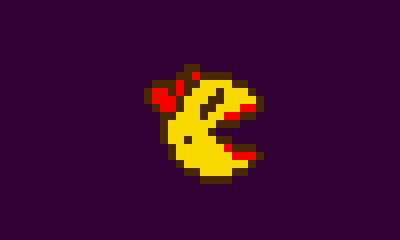

# Sprites and Animation

Pixzig animates sprites with three pieces:

| Type | What it is |
|---|---|
| `FrameSequence` | A list of frames, each a texture shown for some milliseconds. Loops or plays once. |
| `ActorState` | A named way to play a sequence, like `"walk_left"`: a sequence plus an optional flip and a state to go to when it ends. |
| `Actor` | Owns a `Sprite` and plays states on it. |

Sequences and states are shared data that you register once with a `FrameSequenceManager`. Every actor that walks the same way points at the same state.



## Building Sequences in Code

Frames name textures, so load your atlas first. Then build sequences and states and register them with the manager:

=== "Zig"

    ```zig
    const pixzig = @import("pixzig");
    const Frame = pixzig.Frame;
    const FrameSequence = pixzig.FrameSequence;

    _ = try eng.resources.loadAtlas("assets/pac-tiles");

    var seqMgr = try pixzig.FrameSequenceManager.init(alloc);

    const walk = try FrameSequence.init(alloc, &[_]Frame{
        .{ .tex = try eng.resources.getTexture("player_right_1"), .frameTimeMs = 120 },
        .{ .tex = try eng.resources.getTexture("player_right_2"), .frameTimeMs = 120 },
        .{ .tex = try eng.resources.getTexture("player_right_3"), .frameTimeMs = 120 },
    });
    try seqMgr.addSeq("walk", walk); // the manager owns it now

    const walkSeq = seqMgr.getSeq("walk").?;
    try seqMgr.addState(.{ .name = "right", .sequence = walkSeq });
    try seqMgr.addState(.{ .name = "left", .sequence = walkSeq, .flipX = true });
    ```

=== "Python"

    ```python
    # The app owns the animation library; register frames as textures first.
    self.load_texture("hero", "assets/hero.png")
    for i in range(3):
        self.create_subtexture("hero", f"player_right_{i + 1}", i * 16, 0, 16, 16)

    self.create_sequence("walk", loop=True)
    for i in range(3):
        self.add_frame("walk", f"player_right_{i + 1}", 120)

    self.add_anim_state("right", "walk")
    self.add_anim_state("left", "walk", flip=Flip.HORZ)
    ```

One sequence drives both directions here. The `"left"` state flips it.

## Loading Sequences From JSON

For more than a handful of animations, keep them in a file. A sequence file has a list of sequences and a list of states:

```json
{
    "sequences": [
        {
            "name": "walk",
            "mode": "loop",
            "frames": [
                { "name": "player_right_1", "ms": 120, "flip": "none" },
                { "name": "player_right_2", "ms": 120, "flip": "none" },
                { "name": "player_right_3", "ms": 120, "flip": "none" }
            ]
        }
    ],
    "states": [
        { "name": "right", "frameSeqName": "walk", "flip": "none" },
        { "name": "left",  "frameSeqName": "walk", "flip": "horz" }
    ]
}
```

=== "Zig"

    ```zig
    try seqMgr.loadSequenceFile("assets/player.sequences.json", &eng.resources);
    ```

=== "Python"

    ```python
    self.load_anim_file("assets/player.sequences.json")
    ```

Frame `name`s are texture names, so the textures have to be loaded before the file. `flip` is `"none"`, `"horz"`, `"vert"` or `"both"`. A state that names a sequence that doesn't exist fails with `error.UnknownFrameSequence`.

## Playing Them on an Actor

An `Actor` owns the sprite it animates. Add the states it can be in, then call `update` every tick:

=== "Zig"

    ```zig
    // During init:
    self.hero = pixzig.Actor.init(alloc, try eng.resources.createSprite("player_right_1"));
    _ = try self.hero.addState(seqMgr.getState("right").?, .{});
    _ = try self.hero.addState(seqMgr.getState("left").?, .{});
    self.hero.sprite.setOriginNormalized(0.5, 1);

    // In update:
    if (eng.inputs.keyboard.pressed(.left)) try self.hero.setState("left", .{});
    if (eng.inputs.keyboard.pressed(.right)) try self.hero.setState("right", .{});
    self.hero.update(deltaMs);
    self.hero.sprite.setPosF(self.x, self.y);

    // In render:
    eng.renderer.drawSprite(&self.hero.sprite);

    // In deinit:
    self.hero.deinit();
    ```

=== "Python"

    ```python
    # In __init__:
    self.hero = self.create_actor("player_right_1")
    self.hero.add_state("right")
    self.hero.add_state("left")
    self.hero.sprite.set_origin(8, 16)

    # In update:
    if self.keyboard.pressed(Key.LEFT):
        self.hero.set_state("left")
    if self.keyboard.pressed(Key.RIGHT):
        self.hero.set_state("right")
    self.hero.update(dt_ms)
    self.hero.sprite.set_pos(self.x, self.y)

    # In render:
    self.hero.sprite.draw()

    # Freed with the app, or early with self.hero.destroy().
    ```

The first state you add becomes current and its first frame is applied right away. `setState` switches to another state and shows its first frame immediately. Setting the state the actor is already in does nothing, so it's safe to call every tick. Asking for a name you never added returns `error.UnknownActorState`.

`update` steps through as many frames as `deltaMs` covers and keeps the leftover time for the next frame, so an animation keeps its pace however the time arrives. When a play-once state ends partway through a tick, the rest of that tick goes to its `nextState`.

Move, scale and draw the actor through `actor.sprite`. A frame can come from a different texture than the last one; the actor switches the sprite's texture for you. Flips on the frame and on the state combine, and two flips on the same axis cancel out.

### Shared States

`addState` keeps a pointer to the state, not a copy. Any number of actors can use one state, and the state has to outlive them all. Keeping states in a `FrameSequenceManager` that lives as long as the game takes care of that. Re-adding a state or sequence to the manager under the same name updates it in place, so actors pick up the change.

To give a shared state a different name on one actor, pass `.name`. This lets every ghost use plain `"left"` while the manager holds `"red_left"`, `"pink_left"` and so on:

```zig
_ = try ghost.addState(seqMgr.getState("red_left").?, .{ .name = "left" });
```

## Play-Once Animations

A sequence's `mode` is `.loop` by default. Set it to `.once` for something like an attack. When a `.once` sequence ends, the actor switches to the state's `nextState`:

=== "Zig"

    ```zig
    var attack = try FrameSequence.init(alloc, &attackFrames);
    attack.mode = .once;
    try seqMgr.addSeq("attack", attack);
    try seqMgr.addState(.{ .name = "attack", .sequence = seqMgr.getSeq("attack").?, .nextState = "right" });
    _ = try self.hero.addState(seqMgr.getState("attack").?, .{});

    // When the attack button is pressed:
    try self.hero.setState("attack", .{ .reset = true });
    ```

=== "Python"

    ```python
    self.create_sequence("attack", loop=False)
    for name in attack_frames:
        self.add_frame("attack", name, 80)
    self.add_anim_state("attack", "attack", next_state="right")
    self.hero.add_state("attack")

    # When the attack button is pressed. Python's set_state has no reset
    # option, so a press during the attack doesn't restart it.
    self.hero.set_state("attack")
    ```

`.{ .reset = true }` restarts the state from its first frame even if the actor is already in it, so a second press replays the attack.

Without a `nextState`, a `.once` animation holds its last frame and `actor.finished()` returns true until the state changes. In a sequence file, set `"mode": "once"` on the sequence and `"nextStateName"` on the state.

## Cleanup

`actor.deinit()` frees the actor's own state table. `seqMgr.deinit()` frees the sequences and states. Deinit the actors first, since they point into the manager. Textures belong to the resource manager and need no cleanup.

`examples/actor_ex.zig` has walking, flipping and a play-once chomp.
