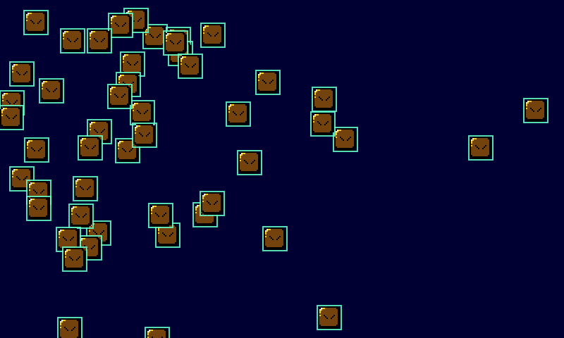

# Entities and Events

Pixzig doesn't force a way to organize your game objects. For small games, a few arrays of structs in your app are plenty. When you want an entity component system, pixzig bundles [flecs](https://www.flecs.dev/) through the [zflecs](https://github.com/zig-gamedev/zflecs) bindings, re-exported as `pixzig.flecs`. For letting systems talk to each other without knowing about each other, there's a small `EventBus`.



## A flecs World

Create a world, register your component types, and add entities:

```zig
const flecs = pixzig.flecs;
const ecs = pixzig.ecs;

pub const Velocity = struct { v: pixzig.Vec2F };

// In init:
self.world = flecs.init();
ecs.registerEngineComponents(self.world); // Sprite, Actor, ecs.Outline
ecs.registerComponents(self.world, .{Velocity});

const e = flecs.new_id(self.world);
var spr = try eng.resources.createSprite("guy");
spr.setPos(40, 40);
flecs.set(self.world, e, pixzig.Sprite, spr);
flecs.set(self.world, e, Velocity, .{ .v = .{ .x = 1, .y = 0.5 } });

// In deinit:
_ = flecs.fini(self.world);
```

Pixzig's own types work fine as components. `Sprite` and `Actor` are the common ones, and the [sequencer](page:sequences) looks for them on entities. `registerComponents` takes any tuple of types, registers zero-sized ones as tags, and is harmless to call twice. Register both `Sprite` and `Actor` even if you only use one, since the helpers below and `MoveToStep` query both; `registerEngineComponents` does that.

## Queries

A query finds every entity with a set of components. Create it once and iterate it each tick:

```zig
// In init:
self.moveQuery = try ecs.query(self.world, .{ pixzig.Sprite, Velocity });

// In update:
var it = flecs.query_iter(self.world, self.moveQuery);
while (flecs.query_next(&it)) {
    const sprites = flecs.field(&it, pixzig.Sprite, 0).?;
    const vels = flecs.field(&it, Velocity, 1).?;
    for (sprites, vels) |*spr, vel| {
        const p = spr.pos();
        spr.setPosF(p.x + vel.v.x, p.y + vel.v.y);
    }
}

// In deinit, before fini:
flecs.query_fini(self.moveQuery);
```

The field index matches the type's position in the tuple. For a term a bare type can't express, put a `flecs.term_t` in the tuple instead, e.g. `.{ Sprite, Velocity, flecs.term_t{ .id = flecs.id(Frozen), .oper = .Not } }`. Use `flecs.get(world, entity, T)` to read a component on one entity, which returns null if it doesn't have one.

## Helper Systems

Every game needs to draw its sprites and animate its actors. `pixzig.ecs` has small systems for that, each owning one query. Call them from your own `update` and `render`:

```zig
// In App:
sprites: ecs.SpriteSystem,
actors: ecs.ActorSystem,
outlines: ecs.DebugOutlines,

// In init (each one registers Sprite, Actor and Outline for you):
self.sprites = try ecs.SpriteSystem.init(self.world);
self.actors = try ecs.ActorSystem.init(self.world);
self.outlines = try ecs.DebugOutlines.init(self.world);
try self.outlines.bindConsole(&eng.scripts, "toggleOutlines");

// In update:
self.actors.update(deltaMs);

// In render, inside begin/end:
self.sprites.draw(&eng.renderer);
self.actors.draw(&eng.renderer);
self.outlines.draw(&eng.renderer);

// In deinit, before fini:
self.sprites.deinit();
self.actors.deinit();
self.outlines.deinit();
```

`DebugOutlines` draws a box around every entity with an `ecs.Outline` component and a `Sprite` or `Actor`. It starts off; flip `enabled`, call `toggle()`, or type the bound function (`toggleOutlines()`) in the console. Set `lineWidth` for thicker boxes.

To keep a camera on an entity, `ecs.followEntity(&cam, world, player, deltaMs, opts)` calls `Camera2D.follow` with the center of its sprite. See [Viewport and Cameras](page:viewport).

For everything else, like systems, pipelines and relationships, see the flecs and zflecs docs. `examples/flecs_ex.zig` moves and draws sprite entities.

## The Event Bus

An `EventBus` passes events to anyone who subscribed. The usual event type is a tagged union, one case per kind of event:

```zig
pub const GameEvent = union(enum) {
    power_dot_eaten: void,
    ghost_eaten: struct { ghost: flecs.entity_t },
    level_cleared: void,
};
pub const EventBus = pixzig.events.EventBus(GameEvent);
```

A subscriber registers a pointer to itself and a callback. The callback gets that pointer back as `*anyopaque`:

```zig
pub const GhostSystem = struct {
    pub fn onEvent(ctx: *anyopaque, event: *GameEvent) void {
        const self: *GhostSystem = @ptrCast(@alignCast(ctx));
        switch (event.*) {
            .power_dot_eaten => self.makeGhostsScared(),
            .ghost_eaten => |e| self.sendHome(e.ghost),
            else => {},
        }
    }
};

// In init:
self.bus = EventBus.init(alloc);
try self.bus.subscribe(&self.ghosts, GhostSystem.onEvent);

// Wherever something happens:
var ev: GameEvent = .power_dot_eaten;
self.bus.emit(&ev);

// In deinit:
self.bus.deinit();
```

`emit` calls every subscriber right away, in the order they subscribed. Subscribers get a pointer to the event, so one can fill in a reply for the code that emitted it. The subscriber has to outlive the bus, or at least every `emit`; there's no unsubscribe.
