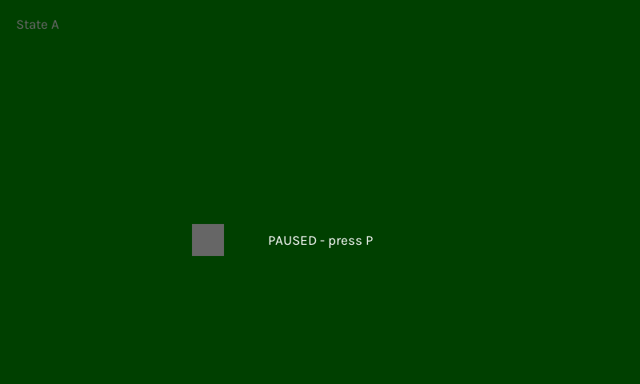

# Game States

Most games have a few distinct screens: a title screen, the game itself, a pause menu, a game over screen. `GameStateMgr` gives each one its own struct and forwards `update` and `render` to whichever is active.

## Defining States

A state is a plain struct with the same `update` and `render` methods as an app. It can also have `activate` and `deactivate`, which run when it becomes active or stops being active:

=== "Zig"

    ```zig
    const TitleState = struct {
        pub fn activate(self: *TitleState) void {
            _ = self;
            std.log.info("showing title", .{});
        }

        pub fn update(self: *TitleState, eng: *AppRunner.Engine, deltaMs: f64) void {
            _ = self;
            _ = deltaMs;
            if (eng.inputs.keyboard.pressed(.escape)) eng.quit();
        }

        pub fn render(self: *TitleState, eng: *AppRunner.Engine, _: f32) void {
            _ = self;
            eng.renderer.clear(0, 0, 80, 255);
        }
    };

    const PlayState = struct { ... };
    ```

=== "Python"

    ```python
    class TitleState(State):
        def __init__(self, app):
            self.app = app

        def activate(self):
            print("showing title")

        def update(self, dt_ms):
            if self.app.keyboard.pressed(Key.ESCAPE):
                self.app.quit()

        def render(self, alpha):
            self.app.render_begin()
            self.app.shapes.filled_rect(0, 0, 800, 480, (0, 0, 80))
            self.app.render_end()

    class PlayState(State): ...
    ```

## Creating the Manager

Name the states with an enum, and list the state types in the same order:

```zig
const States = enum { title, play };

const StateMgr = pixzig.gamestate.GameStateMgr(
    AppRunner.Engine,
    States,
    &[_]type{ TitleState, PlayState },
);
```

The compiler checks that the enum and the list are the same length, and that the enum's values run 0, 1, 2... in order, which is the default when you don't assign any.

Create it with a tuple of pointers to your state instances, in the same order:

=== "Zig"

    ```zig
    self.titleState = .{};
    self.playState = .{};
    self.states = StateMgr.init(.{ &self.titleState, &self.playState });
    ```

=== "Python"

    ```python
    # Python states are objects; there's no enum or type list to declare.
    self.title_state = TitleState(self)
    self.play_state = PlayState(self)
    self.states = StateStack(self.title_state)
    ```

The tuple's type is `StateMgr.StatePtrs`, so a missing state or a pointer of the wrong type is a compile error. The states have to stay put while the manager uses them, so keep them in your heap-allocated app (or somewhere else stable), not in local variables of `init`.

## Using It

Forward the app's methods to the manager and switch states with `setCurrState`:

=== "Zig"

    ```zig
    pub const App = struct {
        titleState: TitleState,
        playState: PlayState,
        states: StateMgr,

        pub fn update(self: *App, eng: *AppRunner.Engine, deltaMs: f64) void {
            if (self.states.current() == .title and eng.inputs.keyboard.pressed(.enter)) {
                self.states.setCurrState(.play);
            }
            self.states.update(eng, deltaMs);
        }

        pub fn render(self: *App, eng: *AppRunner.Engine, alpha: f32) void {
            self.states.render(eng, alpha);
        }
    };
    ```

=== "Python"

    ```python
    class MyGame(App):
        def update(self, dt_ms):
            if self.states.current is self.title_state and self.keyboard.pressed(Key.ENTER):
                self.states.set_state(self.play_state)
            self.states.update(dt_ms)

        def render(self, alpha):
            self.states.render(alpha)
    ```

Some things to know:

- The manager starts on the first state, without calling its `activate`.
- `setCurrState` calls `deactivate` on the old state and `activate` on the new one, when they exist.
- `current()` is the state on top, the one taking input.
- A state's `update` returns `void` or `!void`, like the app's. A state ends the game with `eng.quit()`; an error it returns is logged and quits too.
- `deinit` deactivates every state still on the stack, top first.

States often need to reach back into the game, e.g. to switch states themselves. Give them a pointer to the app, or to a shared game struct, when you create them.

## Pause Menus and Overlays

States form a stack. `push` lays a state over the current one, and `pop` takes it off again, so a pause menu, an inventory or a dialog box doesn't need to know which screen it covers:

=== "Zig"

    ```zig
    if (eng.actions.pressed(.pause)) {
        if (self.states.current() == .pause) {
            try self.states.pop();
        } else {
            try self.states.push(.pause, .{});
        }
    }
    ```

=== "Python"

    ```python
    if self.actions.pressed("pause"):
        if self.states.current is self.pause_state:
            self.states.pop()
        else:
            self.states.push(self.pause_state)
    ```

The options on `push` say what happens to the states underneath while it's on top:

- `renderBelow` (default `true`): render them first, so the pushed state draws over them. A pause menu leaves the game showing behind it, perhaps dimmed with `eng.renderer.fade`. Set it to `false` for a state that covers the whole screen.
- `updateBelow` (default `false`): keep updating them. Off, the game underneath freezes. Turn it on for a popup that shouldn't stop the action.

The options chain: with a HUD pushed with `updateBelow` over a menu pushed without it, the HUD and the menu update and the game stays frozen.

The stack has its own pair of optional hooks, so a state can tell being covered from being left:

- `pause` runs on the state that a `push` covers, and `resume` when the `pop` above it uncovers it again. (Name the method `@"resume"`, since `resume` is a Zig keyword.)
- `activate` and `deactivate` still mean entering and leaving the stack.

A few rules keep the stack simple: a state can be on it only once (`push` of one already there returns `error.StateAlreadyOnStack`), the bottom state can't be popped (`error.LastState`; replace it with `setCurrState`), and `setCurrState` clears the whole stack, deactivating top first, before activating the new state. `depth()` and `isOnStack(state)` report what's on it.

`examples/game_state_ex.zig` switches between two scenes with the number keys, and P pushes a dimmed pause overlay that freezes the scene beneath it.


