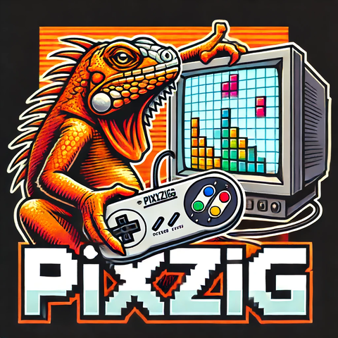
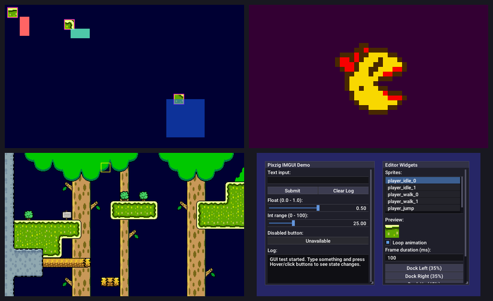

# Getting Started



Pixzig is a 2D game engine written in Zig. It gives you a fixed-timestep game loop, a batched OpenGL renderer, input with action maps, Tiled map loading, audio, Lua scripting, a sequencer for timed events and a small immediate-mode UI. Games build for Linux, Windows and the browser from the same code.

These pages walk through each system in roughly the order you'll need them. Start here, then read [The Game Loop](page:app-runner) and [Rendering](page:rendering).

## Running the Examples

The pixzig repo has an example for most systems in `examples/`. Each one is its own build step:

```sh
zig build render_ex      # sprites and shapes
zig build actor_ex       # sprite animation
zig build tile_load_ex   # a Tiled map with a camera
zig build imgui_ex       # the immediate-mode UI
```



`zig build --help` lists them all. They read the shared `assets/` folder in the repo root.

## Creating a Project

The quickest start is to generate a project from pixzig's `template/` directory. From a pixzig checkout:

```sh
zig build new -Dname=my_cool_game -Ddest=../my_cool_game
cd ../my_cool_game
zig build my_cool_game   # builds and runs it
```

`-Ddest` is relative to the pixzig checkout, or absolute, and defaults to `../<name>`. The name has to be a valid Zig identifier. The new project gets its own `build.zig.zon` fingerprint and a `.path` dependency on the checkout you ran it from. Switch that to a URL and hash when you want a fetched dependency. The tool won't overwrite an existing directory.

You get a window with a bouncing square and a line of text. The rest of this page explains what the template sets up.

## Adding Pixzig to a Project

If you'd rather wire it up by hand, declare pixzig as a dependency in `build.zig.zon`:

```zig
.dependencies = .{
    .pixzig = .{
        .path = "../pixzig", // or a URL + hash for a fetched dep
    },
},
```

Then call `buildGame` from your `build.zig`:

```zig
const std = @import("std");
const pixzig_build = @import("pixzig");

pub fn build(b: *std.Build) void {
    const target = b.standardTargetOptions(.{});
    const optimize = b.standardOptimizeOption(.{});

    const pixzig_dep = b.dependency("pixzig", .{ .target = target, .build_examples = false });

    // No assets yet. See the Assets page to list textures, fonts and maps.
    const manifest = pixzig_build.manifestFromDef(b, .{});

    _ = pixzig_build.buildGame(b, .{
        .target = target,
        .optimize = optimize,
        .engine_dep = pixzig_dep,
        .name = "my_game",
        .root_source_file = b.path("src/main.zig"),
        .manifest = manifest,
    });
}
```

`buildGame` installs the executable to `zig-out/bin/my_game/` as part of `zig build`, and adds a `zig build my_game` step that runs it. It returns the compile step, so you can still tweak it, e.g. `game.use_llvm = true` if you want LLVM's fuller debug info in a debugger.

If the game needs its own imports, build the module yourself and pass it as `.root_module` instead of `.root_source_file`:

```zig
const exe_mod = b.createModule(.{
    .root_source_file = b.path("src/main.zig"),
    .target = target,
    .optimize = optimize,
});
exe_mod.addImport("zargunaught", zargs.module("zargunaught"));
// ... then `.root_module = exe_mod` in buildGame's options.
```

### Build Options

`BuildGameOptions` has a few optional fields:

| Field | Default | What it does |
|---|---|---|
| `default_font` | `.karla` | The font embedded as the renderer's default. Pass `.{ .path = b.path("assets/MyFont.ttf") }` to embed your own, or `.none` to embed nothing. Every game in one `build.zig` shares the engine module, so they must all agree. |
| `package` | `null` | Copy assets next to the executable. Null reads the `-Dpackage` option instead. |
| `install` | `true` | Install to `zig-out/bin/<name>/` on `zig build`. Native only. |
| `wrap_root` | `true` | Generate a small root module that installs pixzig's panic and log handlers, then calls your `main`. |

Because of `wrap_root`, your `main.zig` doesn't need to declare `panic` or `std_options`. Your `main` can be `pub fn main() !void` or `pub fn main(init: std.process.Init) !void`. Only turn wrapping off if your root module provides those declarations itself. With wrapping on, add game-specific imports to the module you pass in (`exe_mod` above), not to the returned compile step's root module, which is the wrapper.

See [Building and Shipping](page:building) for packaging, Windows and web builds.

## A Minimal Game

This opens a window and exits when Escape is pressed:

```zig
const std = @import("std");
const pixzig = @import("pixzig");

const AppRunner = pixzig.AppRunner(App, .{});

pub const App = struct {
    alloc: std.mem.Allocator,

    pub fn init(alloc: std.mem.Allocator, _: *AppRunner.Engine) !*App {
        const app = try alloc.create(App);
        app.* = .{ .alloc = alloc };
        return app;
    }

    pub fn deinit(self: *App) void {
        self.alloc.destroy(self);
    }

    pub fn update(_: *App, eng: *AppRunner.Engine, _: f64) void {
        if (eng.inputs.keyboard.pressed(.escape)) eng.quit();
    }

    pub fn render(_: *App, eng: *AppRunner.Engine) void {
        eng.renderer.clear(26, 26, 51, 255);

        eng.renderer.begin(.logical);
        _ = eng.renderer.drawString("Hello!", .{ .x = 8, .y = 8 });
        eng.renderer.end();
    }
};

pub fn main(init: std.process.Init) !void {
    const appRunner = try AppRunner.init("My Game", init.gpa, .{});
    defer appRunner.deinit();

    const app = try App.init(init.gpa, appRunner.engine);
    defer app.deinit();

    appRunner.run(app);
}
```

That's the whole shape of a pixzig game: an `App` with `update` and `render`, handed to an `AppRunner`. [The Game Loop](page:app-runner) covers what the runner does with it.

