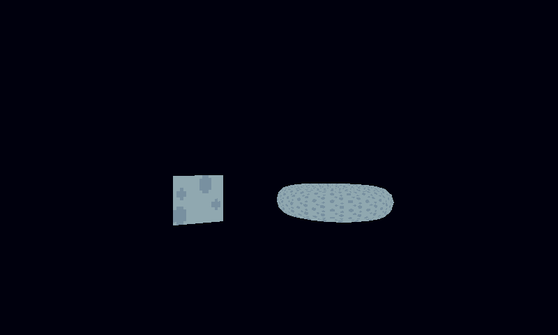

# Low-Level Rendering

The main renderer covers most 2D games. For the rest, pixzig has a few lower-level tools: a pixel buffer for software rendering, textured 3D quads, your own sprite batches and shaders. All of these draw on their own, so call them outside a `renderer.begin`/`end` pair.

## Pixel Buffers

A `PixelBuffer` is a grid of RGB pixels you set one at a time, which is then stretched over the game area. It's the right tool for emulators, fire and plasma effects, or anything else that computes its own pixels:

```zig
// In init:
self.pixels = try pixzig.pixel_buffer.PixelBuffer.init(alloc, &eng.resources, .{ .x = 200, .y = 150 });

// In render:
self.pixels.clear(28, 28, 60);
self.pixels.setPixel(100, 75, 255, 0, 255);
self.pixels.render(); // uploads and draws it

// In deinit:
self.pixels.deinit();
```

`render` uploads the whole buffer each call, so set every pixel you need first. `examples/pixel_buffer_ex.zig` draws a border and a dot.

## 3D Quads

For a first-person dungeon crawler or a raycaster-style view, pixzig can draw textured quads in 3D with depth testing. A `Camera3D` gives you the matrix:

```zig
var cam = pixzig.Camera3D{ .pos = .{ .x = 0, .y = 1.2, .z = -9 }, .yaw = 0 };

const fb = eng.windowState.framebufferSize;
const aspect = @as(f32, @floatFromInt(fb.x)) / @as(f32, @floatFromInt(fb.y));
const viewProj = cam.viewProjMatrix(aspect);
```

`yaw` is the heading in radians; 0 looks down +z. `fovYRadians`, `near` and `far` are fields too, and `forward()` gives the direction it faces.

There are two quad batches. Both take each quad as four corners in the order bottom-left, top-left, top-right, bottom-right, plus a source rect in the texture:

| Type | Use it for |
|---|---|
| `quad3d.Quad3DBatchQueue` | Quads that change every frame. Queue them between `begin` and `end`. |
| `quad3d.Quad3DBatch` | Static geometry like a level's walls. Build once, draw every frame in one call. |

```zig
const quad3d = pixzig.quad3d;
const stone = try eng.resources.getTexture("stone");

// Static walls, built once in init:
self.walls = try quad3d.Quad3DBatch.init(alloc, &eng.resources);
self.walls.beginBuild(&stone.val);
for (wallQuads) |corners| try self.walls.addQuad(corners, stone.val.src);
self.walls.endBuild();

// Dynamic quads, every frame in render:
self.walls.draw(viewProj);

self.dynamic.begin(viewProj, false); // false: keep the walls' depth values
self.dynamic.drawQuad(&stone.val, doorCorners, stone.val.src);
self.dynamic.end();
```

A `Quad3DBatch` uses one texture. Keep one batch per texture if you need several. Depth testing is turned on for the 3D draws and back off afterwards, so 2D drawing that follows, like a HUD, isn't affected.

`examples/quad3d_ex.zig` spins a quad and a torus.



## Your Own Sprite Batch

`eng.renderer` is built on a `renderer.SpriteBatch`. You can make your own, for example to draw into a different matrix without ending the renderer's pass:

```zig
const shader = try eng.resources.getShader(pixzig.shaders.SpriteShader);
var batch = try pixzig.renderer.SpriteBatch.init(alloc, shader);
defer batch.deinit();

batch.begin(eng.projection());
batch.drawSprite(&spr);
batch.drawFilledRect(rect, color);
batch.end();
```

It has the same sprite and rect drawing as the renderer, minus text.

## Shaders

Shaders are resources like textures. The engine registers its built-in ones under names in `pixzig.shaders`: `SpriteShader`, `TextureShader`, `ColorShader`, `PixelBuffShader` and `Quad3DShader`. Load your own from GLSL source:

```zig
const shader = try eng.resources.loadShader("water", &water_vs, &water_fs);
```

Loading the same name again compiles the new program and swaps it in place. Code that caches uniform locations should check the handle's `version` and look them up again when it changes.

`water_vs` and `water_fs` are `pixzig.shaders.ShaderCode` strings. Desktop builds create an OpenGL 4.5 core context and web builds use WebGL 2. Both accept GLSL ES 3.00, so write shaders with `#version 300 es` like the built-in ones in `src/pixzig/renderer/shaders.zig`, and the same source works everywhere.

## Raw OpenGL

`pixzig.gl` is the [zopengl](https://github.com/zig-gamedev/zopengl) bindings, already loaded. If you mix raw GL calls into a frame, call `eng.renderer.flush()` before changing state in a renderer pass, and put back anything you changed (blending, scissor, the bound program) afterwards.
