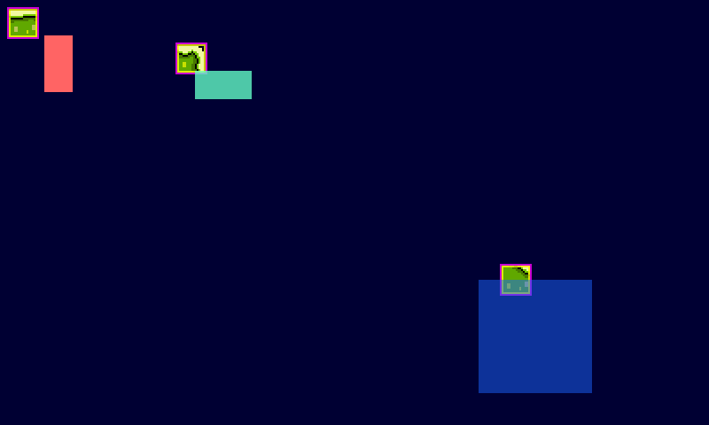

# Rendering

`eng.renderer` draws sprites, textures, rectangles and text. Every draw goes between a `begin` and an `end`, and shows up in the order you submit it.



## A Render Frame

```zig
pub fn render(self: *App, eng: *AppRunner.Engine, _: f32) void {
    eng.renderer.clear(0, 0, 51, 255);

    eng.renderer.begin(.logical);
    eng.renderer.drawSprite(&self.player);
    eng.renderer.drawRect(self.player.dest, Color.from(255, 255, 0, 255), 1);
    eng.renderer.end();
}
```

`clear` takes 0-255 RGBA values. `begin` takes the coordinate space to draw in:

| `begin(...)` | Space |
|---|---|
| `.logical` | The game's logical resolution, y down. The usual choice. |
| `.{ .camera = &cam }` | World space seen through a `Camera2D`. See [Viewport and Cameras](page:viewport). |
| `.screen` | Framebuffer pixels, y down. Covers the whole window, letterbox bars included. Good for debug overlays. |
| `.{ .matrix = m }` | Your own model-view-projection matrix. |

You can run as many passes as you like in one frame. A common pattern is a camera pass for the world and a logical pass for the HUD on top:

```zig
eng.renderer.begin(.{ .camera = &self.camera });
// world: tiles, enemies, the player
eng.renderer.end();

eng.renderer.begin(.logical);
// HUD: score, health
eng.renderer.end();
```

## Batching

Every draw call (sprites, textures, shapes and text) goes into one batch. Consecutive draws that use the same texture go out to the GPU as a single draw call, whatever their color or kind. Switching texture flushes the batch, and so does `end`.

All shapes share a built-in white texture and all text shares the font atlas, so a run of rectangles or a block of text is one call. When draw order doesn't matter, grouping draws by texture keeps the call count down. Pack your sprites into an atlas (see [Assets](page:assets)) and most of a scene becomes one call.

The batch flushes on its own when it fills up. If a scene really draws tens of thousands of quads, raise `rendererOpts.maxSprites` to keep it in one call.

## Drawing Textures

To draw part of a texture, give a destination rect and a source rect in UV coordinates (0 to 1):

```zig
const dest = RectF.fromPosSize(10, 10, 32, 32);
const src = RectF.fromCoords(32, 32, 32, 32, 512, 512); // px, py, pw, ph, texW, texH
eng.renderer.drawTexture(self.tex, dest, src);

eng.renderer.drawFullTexture(self.tex, .{ .x = 10, .y = 50 }, 2.0); // whole texture, 2x
```

`self.tex` is a `*TextureHandle` from the resource manager. [Assets](page:assets) covers loading textures, atlases and subtextures.

## Sprites

For anything that moves, use a `Sprite`. It holds a texture region plus a position, size, origin and color options. Create one from any loaded texture, atlas frame or subtexture:

```zig
// During init:
self.player = try eng.resources.createSprite("player_right_1");
self.player.setPos(100, 50);

// Each frame:
eng.renderer.drawSprite(&self.player);
```

`Sprite.create(handle)` does the same from a handle you already have. A sprite owns nothing, so there's nothing to free.

| Method | What it does |
|---|---|
| `setPos(x, y)`, `setPosF(x, y)` | Place the sprite's origin, in integers or floats. |
| `pos()` | Where the origin is now. |
| `setSize(w, h)`, `setScale(sx, sy)` | Resize, around the origin. `setScale` is relative to the frame's size. |
| `setOrigin(x, y)` | The pivot, in the frame's own pixels. |
| `setOriginNormalized(nx, ny)`, `setOriginCentered()` | The pivot as a fraction of the frame. |
| `setSrcRect(RectI)` | Draw only part of the frame, in pixels. |
| `setTexture(handle)` | Switch to another texture. |

Use these setters rather than writing `dest` yourself. They keep `dest`, `size` and the origin in sync.

Positions are floats, so slow movement accumulates smoothly, but `drawSprite` snaps the sprite to a whole pixel when it draws. A sprite sitting between pixels never comes out blurry.

### Origin

The origin is the sprite's pivot point. `setPos` places it, and scaling grows the sprite around it. It defaults to the top-left corner. For a character, bottom-center is usually what you want:

```zig
spr.setOriginNormalized(0.5, 1); // feet
spr.setPos(100, 50);             // feet at (100, 50)
spr.setScale(2, 2);              // grows up and out; feet stay put
```

`setOrigin(3, 12)` picks an exact pixel of the frame, like a hand holding a weapon. Changing the origin keeps `pos()` where it was and moves the image so the new origin lands on it.

### Tint, Fill and Rotation

`tint` multiplies the sprite's colors. `fill` replaces the color entirely while keeping the shape, which makes the classic white hit flash. `fill.a` blends between the sprite's own color (0) and a solid fill (1), and `fill` wins over `tint` when both are set:

```zig
self.spr.tint = Color{ .r = 1, .g = 0.4, .b = 0.4, .a = 1 }; // reddish
self.spr.fill = Color.from(255, 255, 255, 255);             // white silhouette
self.spr.fill = null;                                       // back to normal
```

For a one-off draw without changing the sprite, use `drawSpriteColored(&spr, color)` or `drawSpriteFilled(&spr, color)`.

`rotate` turns or flips the image in quarter turns: `.none`, `.rot90`, `.rot180`, `.rot270`, `.flipHorz` and `.flipVert`. The sprite's rect stays the same, so quarter turns are meant for square sprites.

To animate sprites, wrap them in an `Actor`. See [Sprites and Animation](page:animation).

## Shapes

```zig
const box = RectF.fromPosSize(50, 50, 100, 40);

eng.renderer.drawFilledRect(box, Color.from(100, 200, 255, 128));
eng.renderer.drawRect(box, Color.from(255, 255, 0, 255), 2);          // border inside the rect
eng.renderer.drawEnclosingRect(box, Color.from(255, 0, 255, 255), 2); // border outside the rect
```

Shapes and text are on by default. Set `rendererOpts.shapeRendering = false` or `textRendering = false` to compile them out. Calling one of their draw functions after that is a compile error that names the option.

## Clipping

`setClip(rect)` clips later draws to a rect in logical coordinates. `setClip(null)` goes back to the normal viewport. It flushes queued draws first, so they keep the clip they were drawn under:

```zig
eng.renderer.setClip(RectF.fromPosSize(10, 10, 100, 60));
// draws here are cut off at the panel's edges
eng.renderer.setClip(null);
```

If you change any other OpenGL state in the middle of a pass, call `eng.renderer.flush()` first so the queued draws go out under the old state.

## Fades and Flashes

`fade(color, amount)` covers the logical screen with `color`, its alpha scaled by `amount` (0 draws nothing, 1 the color as given). It's a pass of its own, so call it between passes, usually last:

```zig
// A hit flash that fades out over 300 ms.
eng.renderer.fade(Color.red, @floatCast(self.flashLeftMs / 300.0));
```

## Blend Modes

`setBlend` changes how the rest of the pass's draws combine with what's behind them:

| `BlendMode` | Effect |
|---|---|
| `.alpha` | Normal transparency (the default). |
| `.additive` | Adds the color, brightening. Glows, fire, lasers. |
| `.multiply` | Multiplies what's behind by the color, darkening. Shadows, tinting. |
| `.premultiplied` | For colors already multiplied by their alpha, such as a render target cleared transparent. |

```zig
eng.renderer.begin(.logical);
eng.renderer.drawSprite(&self.ship);
eng.renderer.setBlend(.additive);
eng.renderer.drawSprite(&self.engineGlow);
eng.renderer.end();
```

Queued draws are flushed first, so they keep the old mode. Every pass starts at `.alpha`, and the mode ends with the pass.

## Render Targets

A `RenderTarget` is an offscreen image you draw into instead of the screen, then draw like any texture. Use one to render a low-resolution game and scale it up, to run a shader over the whole frame, or to draw something expensive once and reuse it.

```zig
// In init: a target a quarter of the logical size.
self.target = try pixzig.RenderTarget.init(.{ .x = 160, .y = 90 }, .{ .filter = .nearest });

// In render:
eng.renderer.setTarget(&self.target);
eng.renderer.begin(.logical);
eng.renderer.clear(0, 0, 0, 255);
// ... draw the scene as usual
eng.renderer.end();
eng.renderer.setTarget(null);

eng.renderer.begin(.logical);
eng.renderer.drawTexture(&self.target.texture, screenRect, self.target.texture.val.src);
eng.renderer.end();

// In deinit:
self.target.deinit();
```

- `setTarget` goes between passes. Until `setTarget(null)`, every pass draws into the target.
- Inside a target, `.logical` and `.camera` passes stretch the logical screen over the whole target, so the scene code doesn't change. A `.screen` pass draws in the target's own pixels. `setClip` takes logical coordinates as usual.
- `target.texture` is a normal `TextureHandle`. Its `src` is already flipped (GL stores the image bottom row first), so pass `texture.val.src` and it draws upright; `drawFullTexture` works too.
- `.nearest` keeps hard pixel edges when the target is scaled up; `.linear` smooths them.
- `resize` reallocates the image, for a target that follows the window size. It starts transparent again.
- A target cleared to a transparent color holds premultiplied colors, so draw it with `setBlend(.premultiplied)` to avoid dark edges.

## Custom Shaders

`createShader` compiles your own fragment shader against the batch's vertex shader, and `setShader` uses it for the rest of the pass. `setUniform` sets its uniforms (`f32`, `i32`, `Vec2F`, `Color` as a `vec4`, or a `zmath.Mat`):

```zig
// In init:
self.wave = try eng.renderer.createShader(&eng.resources, "wave",
    \\#version 300 es
    \\precision mediump float;
    \\in vec2 Texcoord;
    \\in vec4 Col;
    \\flat in float Mode;
    \\uniform sampler2D tex;
    \\uniform float time;
    \\out vec4 fragColor;
    \\void main() {
    \\    vec2 uv = Texcoord + vec2(sin(Texcoord.y * 24.0 + time) * 0.006, 0.0);
    \\    fragColor = texture(tex, uv) * Col;
    \\}
);

// In render:
eng.renderer.begin(.logical);
eng.renderer.setShader(self.wave);
eng.renderer.setUniform("time", seconds);
eng.renderer.drawTexture(&self.target.texture, screenRect, self.target.texture.val.src);
eng.renderer.end();
```

The shader receives `Texcoord`, the draw's color `Col`, its draw `Mode` (0 for textures and shapes, 1 for TTF text, 2 for silhouettes) and the texture `tex`, and writes `fragColor`. `texture(tex, Texcoord) * Col` is the ordinary result for sprites and render targets. Like the blend mode, the shader ends with the pass. `examples/render_target_ex.zig` puts a target, additive blending, a two-pass blur through a second target and a fade together.

## Mixing in Other Renderers

A few renderers draw on their own rather than through the batch: `TileMapRenderer`, `PixelBuffer`, `GridRenderer` and the 3D quad batches. Call them outside a `begin`/`end` pair, between your own passes:

```zig
self.mapRenderer.renderLayersBelow(1.0, &self.camera, &eng.viewport);

eng.renderer.begin(.{ .camera = &self.camera });
eng.renderer.drawSprite(&self.player);
eng.renderer.end();

self.mapRenderer.renderLayersAbove(1.0, &self.camera, &eng.viewport);
```

See [Tile Maps](page:tile-rendering) and [Low-Level Rendering](page:low-level-rendering).

`examples/render_ex.zig` draws textures and shapes, and `examples/actor_ex.zig` draws an animated sprite.
