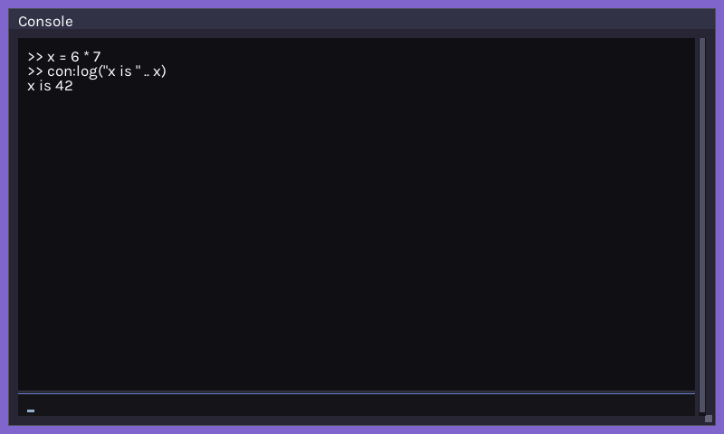

# Scripting and the Console

Pixzig embeds Lua 5.3 through [ziglua](https://github.com/natecraddock/ziglua). `ScriptEngine` wraps a Lua state with a few helpers for the common jobs: running config files, reading settings into structs, and exposing Zig functions to scripts. There's also an in-game Lua console.

## Getting a Script Engine

The easiest way is to let the engine own one:

```zig
const AppRunner = pixzig.AppRunner(App, .{ .scripting = true });

// Anywhere you have the engine:
try eng.scripts.runScript("assets/config.lua");
```

The engine creates it after the renderer and closes it on shutdown. Tools and tests that don't start an engine can make their own:

```zig
var scripts = try pixzig.ScriptEngine.init(alloc);
defer scripts.deinit();
```

The Lua standard libraries (string, table, math and so on) are open. With audio on (the default), the engine also registers its audio functions, like `audio_play` and `music_play`; see [Audio](page:audio).

## Running Lua

```zig
try scripts.run("print('hello from Lua')");     // a string
try scripts.runScript("assets/level1.lua");     // a file
```

Script paths resolve like every other asset (see [Assets](page:assets)). On an error, both log Lua's message and return `error.SyntaxError` or `error.ScriptError`. `runScript` returns `error.ScriptFileError` when the file can't be read.

## Reading a Config Table

`loadStruct` copies a global Lua table into a Zig struct, matching fields by name:

```lua
-- config.lua
config = { fullscreen = true, scale = 4, volume = 0.8, title = "My Game" }
```

```zig
const Config = struct {
    fullscreen: bool = false,
    scale: i32 = 1,
    volume: f32 = 1.0,
    title: ?[]u8 = null,
};

try scripts.runScript("assets/config.lua");
const cfg = try scripts.loadStruct(Config, "config");
defer if (cfg.title) |t| alloc.free(t);
```

Fields can be `bool`, integers, floats and `?[]u8` strings. Every field has to be in the table with the right type. A missing or mistyped field returns `error.InvalidFieldType` rather than falling back to the default, so treat the defaults as documentation. Strings are copied with the allocator the script engine was created with, and you free them. A missing global returns `error.InvalidConfigTable`.

Key bindings have their own loader, `ActionMap.loadFromLua`. See [Input](page:input).

## Calling Zig From Lua

Register a Zig function as a Lua global. It reads its arguments from the Lua stack, pushes its results, and returns how many it pushed:

```zig
const ziglua = pixzig.ziglua;

fn double(lua: *ziglua.Lua) i32 {
    const n = lua.toInteger(1) catch 0; // first argument
    lua.pushInteger(n * 2);
    return 1; // one return value
}

try scripts.registerFunc("double", double);
// Lua: print(double(21))  --> 42
```

When the function needs your game's state, use `registerMethod`. It stores a pointer you give it and passes it back on every call:

```zig
const Game = struct {
    score: i64 = 0,

    fn addScore(self: *Game, lua: *ziglua.Lua) i32 {
        self.score += lua.toInteger(1) catch 0;
        return 0;
    }
};

try scripts.registerMethod(Game, &self.game, "add_score", Game.addScore);
// Lua: add_score(10)
```

The pointer has to stay valid as long as scripts can call the function.

## Passing Values to Lua

Push a value and pop it into a global with `setGlobal`. `scripts.lua` is the raw `*ziglua.Lua` for anything else:

```zig
scripts.lua.pushInteger(@intCast(playerEntity));
scripts.setGlobal("player");
scripts.lua.pushNumber(spawnX);
scripts.setGlobal("spawn_x");

try scripts.runScript("assets/intro.lua");
```

Lua integers are 64-bit signed, so cast entity ids with `@intCast` before pushing them. `getGlobal(name)` pushes a global onto the stack and returns its type, for reading values back.

The [sequencer](page:sequences) uses these pieces to let Lua script cutscenes.

## The Console

The console is a Lua prompt drawn with the [immediate-mode UI](page:ui). Type a line and it runs. Scripts can write to it with `con:log("message")`. Let the engine create it alongside the script engine:

```zig
const AppRunner = pixzig.AppRunner(App, .{
    .inputOpts = .{ .textInput = true }, // the console reads typed text
    .scripting = true,
    .console = .{},                      // ConsoleOpts
});
const UiContext = pixzig.imgui.UiContext(AppRunner.Engine);

// In update:
if (eng.inputs.keyboard.pressed(.grave_accent)) eng.console.toggle();
self.ui.update();

// In render:
eng.renderer.begin(.logical);
self.ui.begin();
eng.console.draw(&self.ui);
self.ui.end();
eng.renderer.end();
```

`ConsoleOpts` sets its size, position, how many lines it keeps, the window title, and whether it starts open (`enabledByDefault`, true by default). With no `displaySize`, it fills the logical screen minus its offsets. Up and Down step through the command history. Asking for `console` without `scripting` is a compile error.



`examples/console_ex.zig` is a complete console, and `examples/lua_ex.zig` shows registering functions without an engine.
