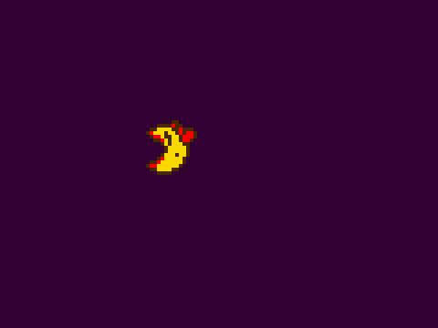

# Sequences

Games are full of little scripted moments: walk the player three tiles to the right, wait half a second, open the door, fade the screen. Writing those as state machines in `update` gets messy fast. The sequencer lets you list the steps in order and play them.

| Type | What it is |
|---|---|
| `Step` | One action, like "wait 500 ms" or "move here over 300 ms". |
| `Sequence` | A list of steps that run one after another. |
| `SequencePlayer` | Runs any number of sequences at once and drops them when they finish. |

The sequencer lives in `pixzig.sequencer`. The examples below use `const seq = pixzig.sequencer;`.



## Playing a Sequence

Keep one `SequencePlayer` for the game and update it every tick. Build a sequence, add steps, and hand it to the player:

```zig
// In App:
seqPlayer: seq.SequencePlayer,

// In init:
self.seqPlayer = seq.SequencePlayer.init(alloc);

// Anywhere, e.g. when the player hits a switch:
var s = seq.Sequence.init(alloc);
try s.add(alloc, try seq.SetActorStateStep.init(alloc, world, player, "walk_right"));
try s.add(alloc, try seq.MoveToStep.init(alloc, world, player, .{ .x = 80, .y = 16 }, 300.0));
try s.add(alloc, try seq.WaitStep.init(alloc, 200.0));
try self.seqPlayer.add(s);

// In update:
self.seqPlayer.update(deltaMs);

// In deinit:
self.seqPlayer.deinit();
```

The player owns the sequence once you add it, and frees it when it finishes. `seqPlayer.sequences.items.len` is how many are still running, which is handy for ignoring input during a cutscene:

```zig
if (self.seqPlayer.sequences.items.len == 0 and eng.actions.pressed(.move_right)) {
    try self.queueMove("walk_right", 16, 0);
}
```

## Tags and Cancelling

Give a sequence a tag when you add it, and you can check on it or stop it later:

```zig
try self.seqPlayer.addTagged(s, "boulder_hit");

if (!self.seqPlayer.isRunning("boulder_hit")) { ... }

// Stops it where it is; its remaining steps never run.
_ = self.seqPlayer.cancel("boulder_hit");

// Stops everything, e.g. when the level changes.
self.seqPlayer.clear();
```

Tags are at most `MAX_NAME_LEN` (64) bytes. Several sequences can share a tag, and `cancel` stops all of them.

Steps can add, cancel or clear sequences while the player is updating, for example from a Lua `seq_call`. A cancel takes effect at once. A sequence added during an update starts on the next one.

## Built-in Steps

### WaitStep

Does nothing for a number of milliseconds:

```zig
try s.add(alloc, try seq.WaitStep.init(alloc, 500.0));
```

### MoveToStep

Moves an entity's sprite to a target position over a duration. The entity lives in a flecs world (see [Entities and Events](page:ecs)) and needs a `Sprite` component, or an `Actor` whose sprite gets moved. Register both component types in the world. Positions are the sprite's origin, and the start position is read when the step begins, not when you create it.

```zig
try s.add(alloc, try seq.MoveToStep.init(alloc, world, entity, .{ .x = 100, .y = 48 }, 300.0));
```

The move is linear. `initEased` takes an easing curve (see [Math and Gameplay Helpers](page:math)), like `.quad_out` to slow into place or `.back_out` to overshoot and settle:

```zig
try s.add(alloc, try seq.MoveToStep.initEased(alloc, world, entity, target, 300.0, .back_out));
```

### SetActorStateStep

Switches an entity's `Actor` to a named animation state and moves on right away:

```zig
try s.add(alloc, try seq.SetActorStateStep.init(alloc, world, entity, "walk_right"));
```

### TweenStep

Tweens one number from `from` to `to` and passes each tick's value to a function of yours. Anything you can drive from one number works: a fade's alpha, a camera zoom, a scale pop.

```zig
fn setFade(self: *Game, alpha: f32) void {
    self.fadeAlpha = alpha;
}

try s.add(alloc, try seq.TweenStep.init(alloc, Game, self, setFade, 0.0, 1.0, 500.0, .sine_in_out));
```

The context pointer has to stay valid while the step runs, so point it at something stable like your game struct, not into a flecs component array.

### TweenValueStep and SetValueStep

When the thing you're animating is just an `f32` in your game struct, these skip the callback. `TweenValueStep` eases the value to a target, starting from whatever it holds when the step begins. A tween can then pick up where an earlier one, or a cancelled one, left off. `SetValueStep` sets it in one go:

```zig
try s.add(alloc, try seq.TweenValueStep.init(alloc, &self.doorOpen, 1.0, 400.0, .quad_out));
try s.add(alloc, try seq.WaitStep.init(alloc, 1000.0));
try s.add(alloc, try seq.SetValueStep.init(alloc, &self.doorOpen, 0.0));
```

### ParallelStep

Runs several steps at the same time, and finishes when all of them have. A sub-step that finishes early isn't run again while the others catch up:

```zig
var par = try seq.ParallelStep.init(alloc);
try seq.ParallelStep.add(&par, alloc, try seq.MoveToStep.init(alloc, world, heroA, targetA, 400.0));
try seq.ParallelStep.add(&par, alloc, try seq.MoveToStep.init(alloc, world, heroB, targetB, 400.0));
try s.add(alloc, par);
```

To run several steps in order as one track inside a `ParallelStep`, wrap them in a sequence and add it as a `SubSequenceStep`:

```zig
var track = seq.Sequence.init(alloc);
try track.add(alloc, try seq.WaitStep.init(alloc, 200.0));
try track.add(alloc, try seq.MoveToStep.init(alloc, world, heroB, targetB, 200.0));
try seq.ParallelStep.add(&par, alloc, try seq.SubSequenceStep.init(alloc, track));
```

### LuaCallStep

Calls a Lua function when the sequence reaches it. It's what `seq_call` adds (see below), and is rarely built from Zig. It holds the function in the Lua registry until it's freed, so free your `SequencePlayer` before closing the Lua state.

## Writing Your Own Steps

A step is a pointer plus a small vtable with `update` and `deinit`. Steps for things the engine doesn't know about, like screen flashes or sound cues, live in your game:

```zig
pub const PlaySoundStep = struct {
    eng: *AppRunner.Engine,
    name: []const u8,

    const vtable: seq.Step.VTable = .{ .update = update, .deinit = deinit };

    pub fn init(alloc: std.mem.Allocator, eng: *AppRunner.Engine, name: []const u8) !seq.Step {
        const self = try alloc.create(PlaySoundStep);
        self.* = .{ .eng = eng, .name = name };
        return .{ .ptr = self, .vtable = &vtable };
    }

    fn update(step: *seq.Step, _: f64) f64 {
        const self: *PlaySoundStep = @ptrCast(@alignCast(step.ptr));
        _ = self.eng.audio.play(self.name, .{}) catch {};
        step.done = true;
        return -1.0;
    }

    fn deinit(step: *seq.Step, alloc: std.mem.Allocator) void {
        const self: *PlaySoundStep = @ptrCast(@alignCast(step.ptr));
        alloc.destroy(self);
    }
};
```

`update` gets the elapsed milliseconds and returns the time it has left. When the step is finished, set `step.done = true` and return a negative number, and the sequence moves to the next step. `deinit` frees whatever the step allocated, and runs when the sequence is freed.

## Building Sequences From Lua

`SeqScriptingContext` lets Lua scripts build and play sequences. Bind it to a script engine once:

```zig
self.seqCtx = seq.SeqScriptingContext.init(alloc, world, &self.seqPlayer);
try self.seqCtx.bindToLua(&eng.scripts);
```

That adds these Lua functions:

| Function | What it does |
|---|---|
| `seq_new() -> handle` | Start a new sequence. |
| `seq_wait(h, ms)` | Add a `WaitStep`. |
| `seq_move_to(h, entity, x, y, ms [, ease])` | Add a `MoveToStep`. `ease` is a curve name like `"quad_out"`; linear when left out. |
| `seq_set_actor_state(h, entity, name)` | Add a `SetActorStateStep`. |
| `seq_tween(h, value, to, ms [, ease])` | Add a `TweenValueStep` on a registered value (see below). |
| `seq_set(h, value, v)` | Add a `SetValueStep` on a registered value. |
| `seq_call(h, fn)` | Add a `LuaCallStep` that calls `fn` when reached. An error in `fn` is logged and the sequence carries on. |
| `seq_parallel(h, h1, h2, ...)` | Add a `ParallelStep` that runs the sequences `h1`, `h2`, ... side by side. Like `seq_play`, it uses those handles up. |
| `seq_play(h [, tag])` | Hand the sequence to the player, tagged if `tag` is given. |
| `seq_running(tag) -> bool` | Whether a sequence with that tag is playing. |
| `seq_cancel(tag) -> count` | Stop every sequence with that tag. |
| `value_get(value) -> number` | Read a registered value right away (nil if there's no such value). |
| `value_set(value, v)` | Set a registered value right away. |

### Registered Values

Scripts can't reach into your structs, so you hand them `f32`s by name. Anything you draw or simulate from one number can then be animated by a script:

```zig
try self.seqCtx.registerValue("door_open", &self.doorOpen);
```

```lua
local h = seq_new()
seq_tween(h, "door_open", 1, 400, "quad_out")
seq_wait(h, 1000)
seq_tween(h, "door_open", 0, 400)
seq_play(h, "door")
```

The pointer has to outlive the context and any sequence tweening it. An unknown value name logs a warning and the step isn't added.

### Hooks Into the Game

`seq_call` runs any Lua function, so the game's own Lua functions (registered with `ScriptEngine.registerFunc` or `registerMethod`) become sequence steps without writing a Zig `Step` for each one:

```lua
local h = seq_new()
seq_wait(h, 3000)
seq_call(h, function() play_sound("scare") end)
seq_tween(h, "scare", 1, 800)
seq_play(h, "stalker")
```

A function called this way can play and cancel sequences itself, including the one it's part of. That's how a script chains one sequence into the next, or stops a cooldown.

Lua doesn't know about your entities, so pass in what the script needs as globals before running it:

```zig
const scripts = &eng.scripts;
scripts.lua.pushInteger(@intCast(self.player));
scripts.setGlobal("player");

const pos = flecs.get(world, self.player, pixzig.Actor).?.sprite.pos();
scripts.lua.pushNumber(pos.x);
scripts.setGlobal("player_x");
scripts.lua.pushNumber(pos.y);
scripts.setGlobal("player_y");

try scripts.runScript("assets/circle_move.lua");
```

```lua
-- circle_move.lua: walk a 16 pixel square
local h = seq_new()
seq_set_actor_state(h, player, "right")
seq_move_to(h, player, player_x + 16, player_y, 300)
seq_set_actor_state(h, player, "down")
seq_move_to(h, player, player_x + 16, player_y + 16, 300)
seq_set_actor_state(h, player, "left")
seq_move_to(h, player, player_x, player_y + 16, 300)
seq_set_actor_state(h, player, "up")
seq_move_to(h, player, player_x, player_y, 300, "quad_out")
seq_play(h)
```

The context must stay alive, and not move, as long as scripts can call these functions. Call `seqCtx.deinit()` when you're done to free any sequences a script started but never played.

`examples/sequencer_ex.zig` runs this script, plus a custom flash step.
