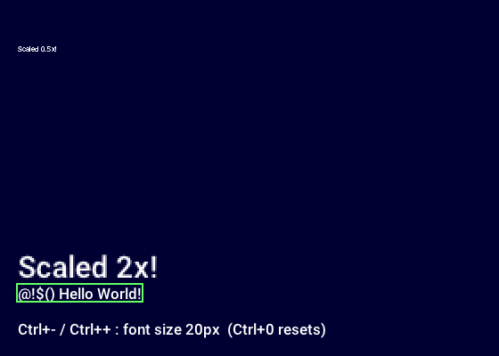
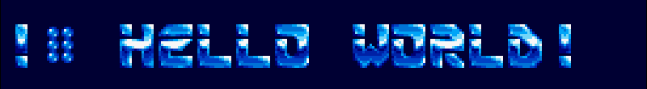

# Text and Fonts

The renderer draws text with one default font. Out of the box that's Karla at 20 pixels, embedded in your executable by `buildGame`, so `drawString` works with no setup at all.

## Drawing Text

Text draws inside a `begin`/`end` pair like everything else, at an integer position:

```zig
eng.renderer.begin(.logical);
const size = eng.renderer.drawString("Score: 100", .{ .x = 8, .y = 8 });
_ = eng.renderer.drawStringColored("Game Over", .{ .x = 100, .y = 80 }, Color.from(255, 80, 80, 255));
_ = eng.renderer.drawScaledString("Big", .{ .x = 8, .y = 40 }, 2.0);
eng.renderer.end();
```

Positions are `Vec2F`, like sprites and the mouse. Each draw call returns the size of the text it drew, also a `Vec2F`, which is handy for boxes and backgrounds. To lay out text before drawing it, use `measureString(text)` and `lineHeight()`. `drawClippedString(text, pos, clipRect)` trims glyphs at the clip rect's edges, for text in a scrolling panel.

Glyphs are packed into the font atlas the first time they're drawn. Text is UTF-8, so Japanese, accented letters and symbols work as long as the font has them.



## Picking the Default Font

Set the default font with `renderInitOpts.font` when creating the runner. It's a `FontSource`:

```zig
const appRunner = try AppRunner.init("My Game", alloc, .{
    .renderInitOpts = .{ .font = .{ .path = .{
        .face = "assets/Roboto-Medium.ttf",
        .size = 18.0,
    } } },
});
```

| `FontSource` | Font |
|---|---|
| `.embedded` | The font `buildGame` compiled in (the default). `.{ .embedded = .{ .size = 16 } }` changes its size. |
| `.path` | A TTF/OTF file. `faceIndex` picks a face inside a `.ttc` collection. |
| `.data` | Font bytes already in memory, e.g. `.{ .data = .{ .bytes = @embedFile("MyFont.ttf"), .size = 18 } }`. |
| `.id` | A font already loaded into the resource manager, such as one from a manifest boot group. |
| `.none` | No default font, for a game that sets its font later. |

To embed a different font than Karla, set `default_font` in `buildGame` (see [Getting Started](../index.html)). With `default_font = .none`, `.embedded` loads nothing and logs a warning at startup. Drawing text with no font set draws nothing and logs one error the first time.

You can also switch fonts after startup. Load a font into the resource manager, then make it the default:

```zig
_ = try eng.resources.loadFontFromTtfFile("ui", "assets/Roboto-Medium.ttf", 16.0);
try eng.renderer.setDefaultFont(&eng.resources, "ui");
```

## Bitmap Fonts

A bitmap font is a PNG laid out as a grid of fixed-size cells. Give the cell size, how many cells are in a row, and the characters in order:

```zig
_ = try eng.resources.loadFontFromBitmap(
    "font5r",
    "assets/font5r.png",
    16, 19, // cell width and height
    19,     // cells per row
    "abcdefghijklmnopqrstuvwxyz| 0123456789*#!`:.,\\?-+=$&%()'",
);
try eng.renderer.setDefaultFont(&eng.resources, "font5r");
```

Start the renderer with `.font = .none` when you're going to swap in a bitmap font, so it doesn't load the embedded one for nothing. `drawStringColored` tints bitmap fonts too. See `examples/bitmap_text_rendering_ex.zig`.



## Fallback Fonts

If the main font lacks some characters, add a fallback face. Characters the main face doesn't have are drawn from the fallback:

```zig
try eng.renderer.addDefaultFontFallback(&eng.resources, "assets/NotoSansJP-Regular.ttf", 0);
```

Characters no face has draw as an empty box. A hot reload of the main font file drops its fallbacks, so add them again after one if it matters.

## Changing the Size at Runtime

`eng.defaultFontAtlas()` gives you the live atlas, or null when there's no default font. `setFontSize` repacks it at a new pixel size, and the next `drawString` uses it:

```zig
const kb = &eng.inputs.keyboard;
if (kb.ctrl()) {
    if (eng.defaultFontAtlas()) |fa| {
        if (kb.pressed(.minus)) fa.setFontSize(@max(8, fa.fontSize - 2)) catch {};
        if (kb.pressed(.equal)) fa.setFontSize(@min(72, fa.fontSize + 2)) catch {};
    }
}
```

- The engine uses the size as given. Any min, max or step is yours to decide.
- It re-rasterizes every glyph, so call it on a key press, not every frame, and outside a `begin`/`end` pair.
- A bitmap font returns `error.NotAScalableFont`.
- A hot reload of the font file rebuilds it at its original size.

`examples/text_rendering_ex.zig` shows scaled text and runtime resizing.
