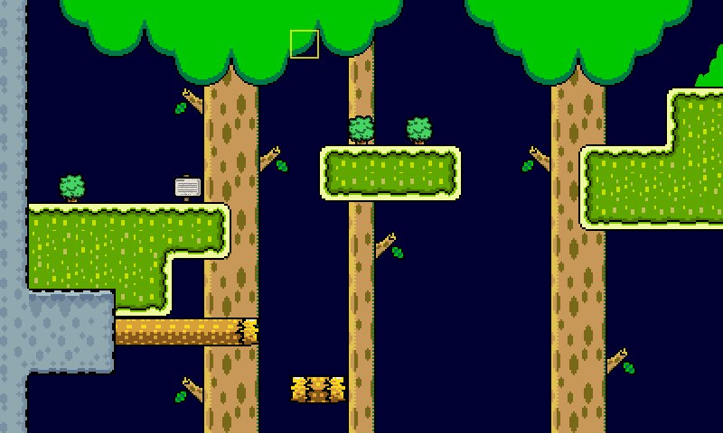

# Tile Maps

Pixzig loads maps made in [Tiled](https://www.mapeditor.org/) and draws them with a `TileMapRenderer`. Tiles can carry collision flags and custom properties, and object layers give you spawn points and triggers.



## Loading and Drawing a Map

Load the `.tmx` through the resource manager, then build a renderer from the map's name:

```zig
// In init:
_ = try eng.resources.loadTileMap("level1", "assets/level1.tmx");
self.mapRenderer = try pixzig.TileMapRenderer.init(alloc, &eng.resources, "level1");

// In render:
self.mapRenderer.render(&self.camera, &eng.viewport);

// In deinit:
self.mapRenderer.deinit();
```

The renderer works out the rest itself. It loads each layer's tileset image, as named by the `<image source>` in the `.tmx`, and only draws the parts of the map the camera can see. The map's file paths are relative to the `.tmx`, so keep them as Tiled wrote them.

Tile maps draw on their own rather than through the sprite batch, so call the render functions outside a `renderer.begin`/`end` pair.

## Layers and Draw Order

Usually you want some layers behind your sprites and some in front. Give each layer a `z` float property in Tiled, then draw the map in two halves:

```zig
self.mapRenderer.renderLayersBelow(1.0, &self.camera, &eng.viewport);

eng.renderer.begin(.{ .camera = &self.camera });
eng.renderer.drawSprite(&self.player);
eng.renderer.end();

self.mapRenderer.renderLayersAbove(1.0, &self.camera, &eng.viewport);
```

The renderer reads these layer properties:

| Property | Type | Default | Effect |
|---|---|---|---|
| `z` | float | `0.0` | Draw order. Lower draws first. |
| `parallax_x` | float | `1.0` | Horizontal scroll speed relative to the camera. 0.5 scrolls at half speed. |
| `parallax_y` | float | `1.0` | Vertical scroll speed relative to the camera. |

`render` draws every layer in `z` order. `renderLayerNamed("background", ...)` and `renderLayer(index, ...)` draw a single layer.

## Reading the Map

`mapRenderer.tileMap()` is the map it draws. You can also get it with `eng.resources.getTileMap("level1")`.

```zig
const map = self.mapRenderer.tileMap();
const ground = map.layerByName("ground").?;

const size = ground.size;          // in tiles
const tileSize = ground.tileSize;  // in pixels
const index = ground.tileData(x, y); // -1 for an empty cell
const tile = ground.tile(x, y);      // ?*Tile, with its flags and properties
```

### Tile Properties

Give tiles in your Tiled tileset custom properties to describe them. Two property names are special and set flags in `tile.core`:

| Property | Values | Flag |
|---|---|---|
| `blocks` | `left`, `right`, `top`, `bottom`, `all` | `tile.BlocksLeft`, ..., `tile.BlocksAll` |
| `kills` | `true` | `tile.Kills` |

```zig
if (ground.tile(tx, ty)) |t| {
    if (t.core & pixzig.tile.Kills != 0) self.die();
}
```

Every other property is kept as a string in `tile.properties`. The blocking flags are what [Collision and Pathfinding](page:collision) uses to stop movement and plan paths.

### Objects

Object layers come in as `ObjectGroup`s, which is the usual place for spawn points, doors and triggers:

```zig
const spawns = map.objectGroupByName("spawns").?;

if (spawns.firstByClass("player")) |p| {
    self.player.setPos(p.pos.x, p.pos.y);
}

var it = spawns.iterator("enemy"); // pass null for every object
while (it.next()) |obj| {
    try self.spawnEnemy(obj.pos, obj.intPropWithDefault("hp", 3));
}
```

An object has an `id`, `name`, `class`, `pos`, `size` and custom properties, read with `intProp`, `intPropWithDefault` and `stringProp`. Tiled's older `type` attribute is read as the class too.

## Changing Tiles at Runtime

For a map the game edits as it runs, like digging or placing blocks, change the tile data and tell the renderer which tile changed:

```zig
layer.setTileData(x, y, newIndex);
self.mapRenderer.tileChanged(layerIndex, x, y);
```

Only the chunk holding that tile is rebuilt, on its next draw. After changing lots of tiles at once, `rebuildAll()` rebuilds everything right away.

To render a map you generate in code, build a `TileMap` and register it with `eng.resources.addTileMap("generated", map)`, which takes ownership. Set each tileset's `imageSource` to the name of a texture you've already loaded and the renderer will use it.

## Hot Reload

Edit and save the map in Tiled while a debug build is running and it reloads. Every render call checks for a reload first and rebuilds its layers, including added, removed or reordered ones. There's nothing to wire up.

If you derived something from the map, like camera bounds or spawn points, call `sync()` in `update`. It returns true when a reload just happened:

```zig
if (self.mapRenderer.sync()) {
    self.camera.bounds = self.mapBounds();
}
```

A reload replaces the map's contents in place, so don't keep pointers into it across frames. Look layers up again instead.

## Supported Tiled Features

Pixzig reads a practical subset of the `.tmx` format:

- **Layer data:** CSV only. Base64 and compressed layers fail with `error.UnsupportedLayerEncoding`.
- **Tilesets:** inline in the `.tmx`, one tileset per layer. Several tilesets per map are fine as long as each layer uses only one.
- **Properties:** on layers, tiles and objects.

Not supported:

- Layers that mix tiles from more than one tileset.
- External `.tsx` tileset files.
- Flipped or rotated tiles.
- Image collection tilesets and object templates.

In Tiled, set the map's tile layer format to CSV and embed your tilesets, and you'll stay inside what pixzig reads.

## Debug Grid

`tile.GridRenderer` draws grid lines over an area, which helps when debugging collision or placement. It doesn't read a map, just sizes:

```zig
var grid = try pixzig.tile.GridRenderer.init(
    alloc,
    try eng.resources.getShader(pixzig.shaders.ColorShader),
    .{ .x = 20, .y = 12 },  // cells
    .{ .x = 16, .y = 16 },  // cell size
    1,                      // line width
    Color.from(255, 0, 255, 255),
);
defer grid.deinit();

// In render, outside a renderer pass:
try grid.draw(self.camera.matrix(&eng.viewport));
```

`examples/tile_load_ex.zig` loads a map, follows a box with a camera and collides it against the walls.
